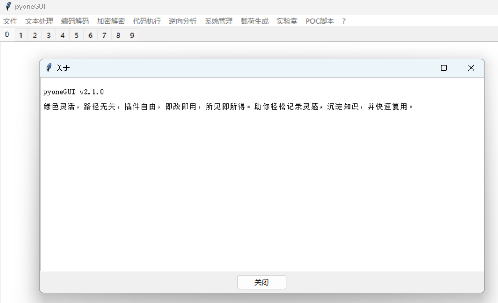
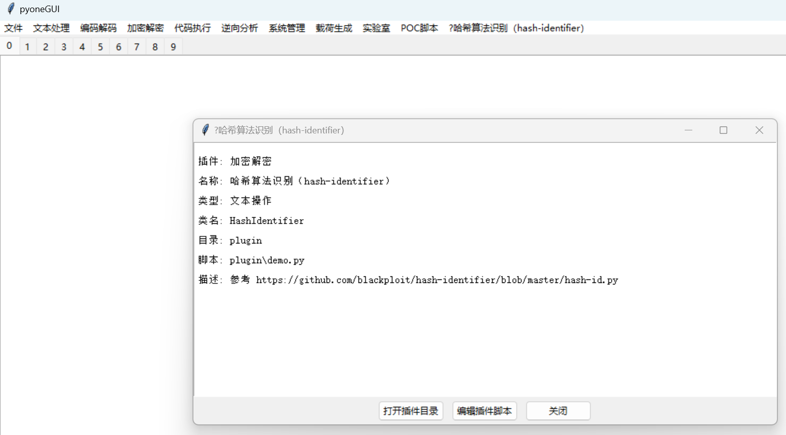
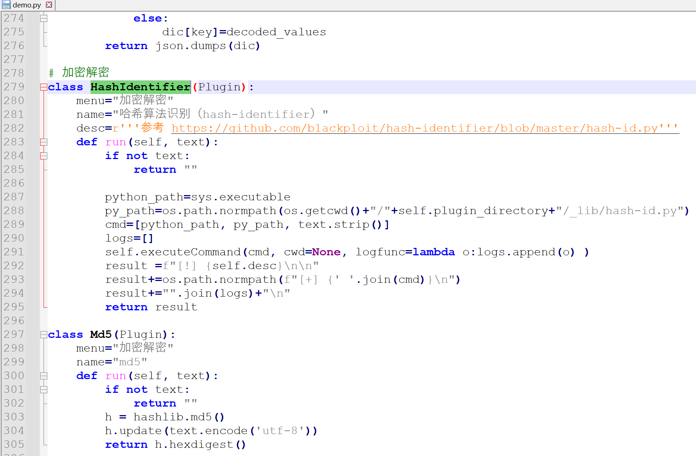
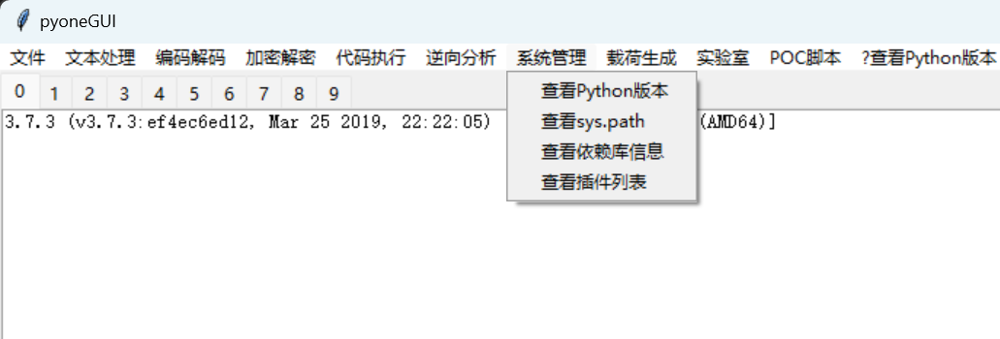
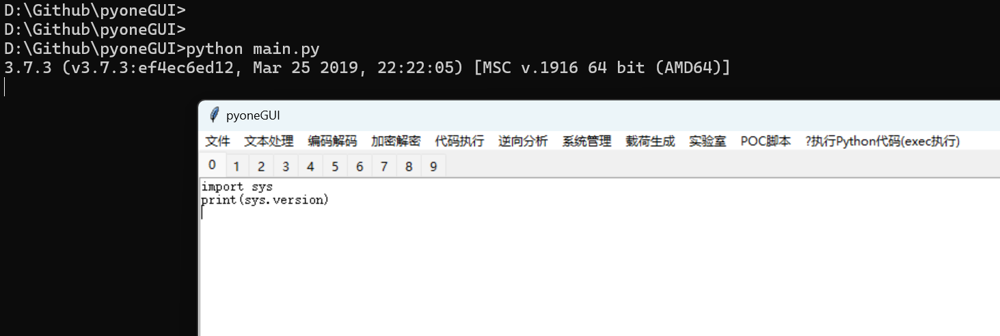
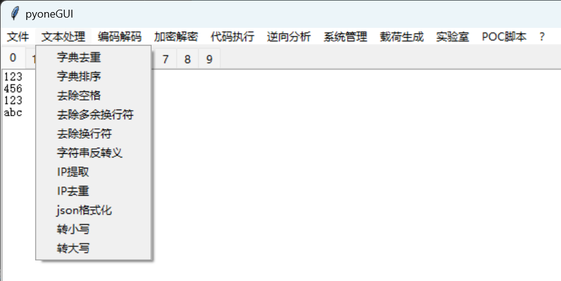
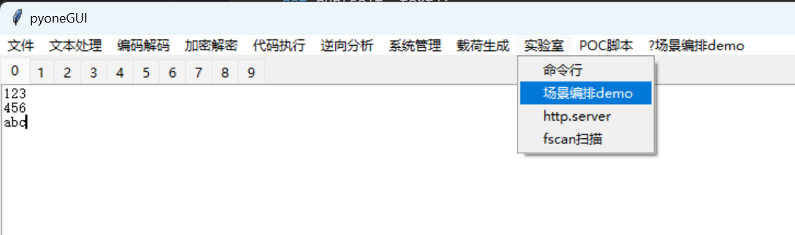
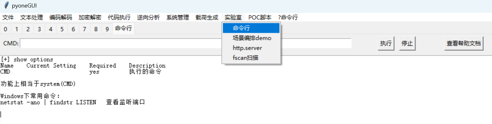
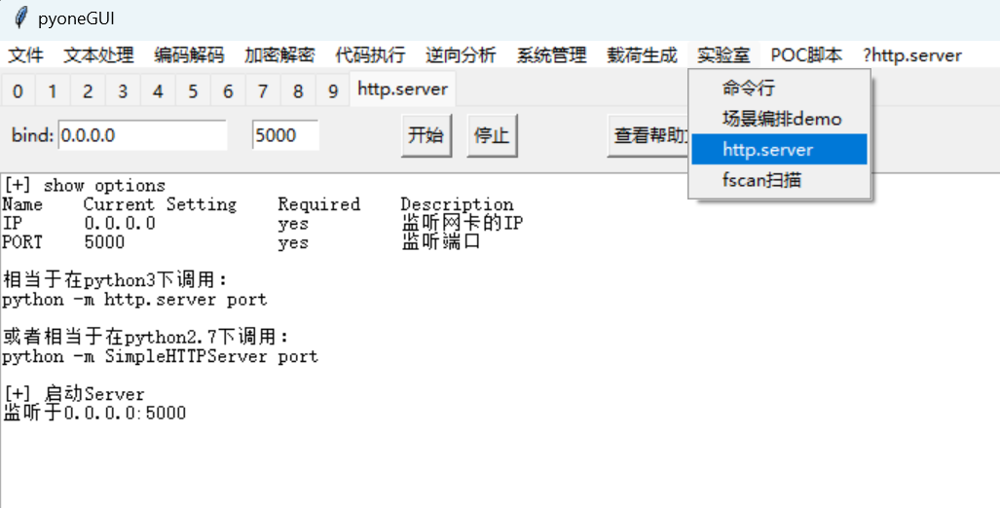
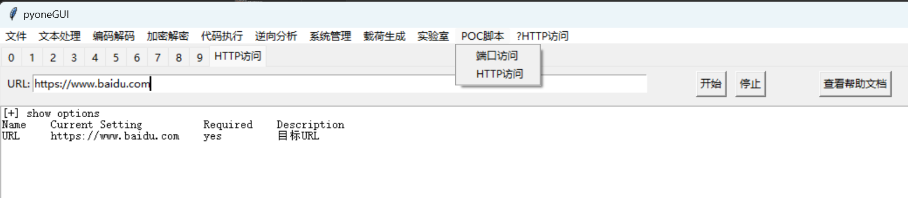

# pyoneGUI
自pyoneGUI_v2.0起，构建了一个绿色版的Python环境，并安装了requests、pwntools等常用库。在此基础上，开发了一套很有特色的插件机制，允许便捷地编写Python代码并将其集成到图形界面菜单中。该项目旨在帮助高效管理编程灵感，持续积累技术经验，并通过插件模块快速复用提升效率。







# 环境依赖
```
这些版本下有效，其他版本未测试（2025.4.29更新）
1.Win10下正常，Win7下报错
Python: 3.12.0 (tags/v3.12.0:0fb18b0, Oct  2 2023, 13:03:39) [MSC v.1935 64 bit (AMD64)]
tkinter.TkVersion: 8.6
pyinstaller: 6.2.0

2.Win11下正常，Win10下正常，Win7_64位下正常
Python: 3.7.3 (v3.7.3:ef4ec6ed12, Mar 25 2019, 21:26:53) [MSC v.1916 32 bit (Intel)]
tkinter.TkVersion: 8.6
pyinstaller: 5.13.2

3.Win11下正常，Win10下正常，Win7_64位下正常
Python: 3.7.3 (v3.7.3:ef4ec6ed12, Mar 25 2019, 22:22:05) [MSC v.1916 64 bit (AMD64)]  （目前主要以此版本的Python为基础进行开发和测试，如 pyoneGUI_v2.1.0）
tkinter.TkVersion: 8.6
```

# 查看版本
## 通过“系统管理”菜单查看


## 通过自定义Python代码查看
例如
```python
查看python版本
import sys
print(sys.version)

查看操作系统版本
import platform
print(platform.platform())

查看依赖库信息
import sys
for module_name in sys.modules:
    print(module_name)

查看requests库的版本
import requests
print(requests.__version__)

```


# 插件编写举例说明
**注：当前阶段，pyoneGUI的特色不在插件上，而是在插件管理的机制上。**

每个插件都是Plugin类的子类，**只要在plugin目录下随便建一个py文件，写个Plugin子类就是一个新的插件。** 需要注意的是，每个插件类的类名是唯一的，不能重复，否则会丢失之前定义的同名插件。

## 字典去重
“字典去重”这个插件是在demo.py中实现的，其类名为RemoveDuplicates（唯一），menu和name分别是菜单名称和插件名称，这两个值决定了插件的显示名称。
```python
class RemoveDuplicates(Plugin):
    menu="文本处理"
    name="字典去重"
    def run(self, text):
        if not text:
            return ""
        words = text.strip().replace("\r\n", "\n").split("\n")
        return "\n".join(list(dict.fromkeys(words)))
```



## json格式化
“json格式化”这个插件是在demo.py中实现的
```python
class JsonView(Plugin):
    menu="文本处理"
    name="json格式化"
    def run(self, text):
        if not text:
            return ""
        j=json.loads(text)
        #formatted_json = json.dumps(j, indent=4)
        formatted_json = json.dumps(j, indent=4, ensure_ascii=False)
        return formatted_json
```

## 场景编排demo
“场景编排demo”这个插件是在laboratory.py中实现的，这是一个实验性质的插件，其展示了场景编排能力，可以把其他的插件组合在一起，按照新的逻辑处理任务。
```python
class WorkflowOrchestration(Plugin):
    menu="实验室"
    name="场景编排demo"
    type="text"
    def run(self, text):
        tasks=[]
        tasks+=[RemoveDuplicates]
        tasks+=[ToLower]
        tasks+=[SortLines]
        
        for _ in tasks:
            text=_().run(text)
        
        return text
```



## 命令行
“命令行”这个插件是在laboratory.py中实现的，可以执行系统命令。这是一个有自定义界面的插件，其type类型为laboratory，通过buildWindow函数绘制了插件界面，并返回了self.output_text，点击“开始”的时候执行onStart函数，点击“查看帮助文档”的时候执行showHelp函数。
```python
class CMD(Plugin):
    menu="实验室"
    name="命令行"
    type="laboratory"
    def buildWindow(self):
        tab_laboratory = self.frame_args["tab_laboratory"]
        此处省略一些画界面的代码

        # 设置options
        self.options=Options()
        dic={"Name":"CMD", "Current Setting":"", "Required":"yes", "Description":"执行的命令", "obj":cmd_entry }
        self.options.append(dic)
        return self.output_text
        
    def onStart(self, event=None):
        options=self.getOptions()
        cmd=options["CMD"]
        
        self.log(f"[+] {cmd}\n")
        self.executeCommand(cmd, logfunc=self.log)
        # TODO：添加自定义命令，并使自定义命令和系统命令都支持管道

    def onStop(self, event=None):
        self.log("[*] onStop\n")
            
    def showHelp(self, event=None):
        super().showHelp()
        help="功能上相当于system(CMD)\n\n"\
             "Windows下常用命令：\n"\
             "netstat -ano | findstr LISTEN\t\t\t查看监听端口\n"\
             "\n"
        self.log(help)
```


## http.server
“http.server”这个插件是在laboratory.py中实现的，点击开始按钮会启动一个简单的HTTP服务，可以用来下载文件。
```python
class HttpServer(Plugin):
    menu="实验室"
    name="http.server"
    type="laboratory"
    server=None
    def buildWindow(self):
        tab_laboratory = self.frame_args["tab_laboratory"]
        此处省略一些画界面的代码

        # 设置options
        self.options=Options()
        dic={"Name":"IP", "Current Setting":"", "Required":"yes", "Description":"监听网卡的IP", "obj":ip_entry }
        self.options.append(dic)
        dic={"Name":"PORT", "Current Setting":"", "Required":"yes", "Description":"监听端口", "obj":port_entry }
        self.options.append(dic)
        
        #MyHandler里会用
        PluginGlobalStorage[self.__class__.__name__]={"class_obj":self}
        return self.output_text
        
    def onStart(self, event=None):
        options=self.getOptions()
        IP=options["IP"]
        PORT=int(options["PORT"])
        
        class MyHandler(http.server.SimpleHTTPRequestHandler):
            def log_message(self, format, *args):
                msg=format%args
                obj=PluginGlobalStorage["HttpServer"]["class_obj"]
                obj.log(msg+"\n")
                
        def fn():
            with socketserver.TCPServer((IP, PORT), MyHandler) as self.server:
                self.log(f"监听于{IP}:{PORT}\n")
                self.server.serve_forever()
                
        self.log("[+] 启动Server\n")
        thread = threading.Thread(target=fn)
        thread.start()

    def onStop(self, event=None):
        if self.server:
            self.log("[+] 关闭Server\n")
            self.server.shutdown()
            self.server=None
        else:
            self.log("[*] Server未启动\n")
            
    def showHelp(self, event=None):
        super().showHelp()
        self.log("相当于在python3下调用：\n")
        self.log("python -m http.server port\n\n")
        self.log("或者相当于在python2.7下调用：\n")
        self.log("python -m SimpleHTTPServer port\n\n")
```



## HTTP访问
"HTTP访问"这个插件是在poc.py中实现的，可以访问指定的URL地址并返回结果，是PoC功能的一个例子。这个插件没有定义buildWindow函数，而是使用的父类Plugin默认的buildWindow函数完成的界面绘制。
```python
class HttpGet(Plugin):
    menu="POC脚本"
    name="HTTP访问"
    type="laboratory"
    def onStart(self, event=None):
        options=self.getOptions()
        try:
            res = requests.get(options["URL"], headers=self.headers, timeout=3, verify=False)
            if 200==res.status_code:
                self.log(res.content.decode("utf-8"))
        except Exception as e:
            print(e)
```



# 其他说明
```
1. 出于时间和动力方面的考虑，作者目前并没有提供Linux版本的pyoneGUI，但是如果要自己制作一个的话，应该也不难。
```

# 下一步计划
寻找有趣的点，丰富插件功能。
